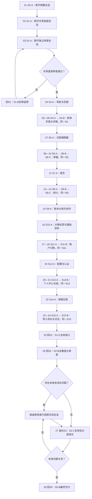

# FortuneBoot-App 全量设计整改：S系列会话提示词

本包生成于2026-11-05。**28份主线提示词＋16份条件返修/补缺提示词，共44份**。逐条覆盖277个模块ID、45个DT、12个CX，合计334个审计编号。已存在的底座先验证复用，不重复推倒重写。

**这次只生成提示词，没有执行S0-A，也没有继续修改业务源码。** 所有runtime阶段初始化为NOT_STARTED。

## 使用规则

1. **S编号=一个固定会话；A/B/C/D/E=回到该会话的轮次。** 例如S4-A与S4-B放同一S4会话，S1-C回到先前S1会话。
2. **按下面01—28序号执行，全部串行。** 不按S编号把所有A先执行，也不要同时开启多个写代码会话。
3. 每份文件均有完整公共约束、该阶段具体任务、问题ID、允许文件、测试场景、视觉验收和下一步；可整份复制，不需要另外拼一段“公共提示词”。
4. 一个阶段完成后停止，用户再发送下一份。前序handoff和runtime必须有真实证据，口头“完成”不算。
5. 源码、图片与测试证据均共享于当前工作区。Markdown受既有*.md忽略规则影响，文件真实存在；未提交状态正常，不强行清理或修改忽略规则。
6. 一次测试通过只证明对应快照。未查看实际图不能自称视觉通过，未真机/联调不能声称上线验收。
7. 实现会话独立执行；**S2只读审查，绝不自己修代码**。返修回原owner，复审仍回S2。
8. 当前只是本地整改授权，不包含commit、push、发布、真实账本写入、改后端、启用内购或绕过认证/应用锁。

完整单文件合集：[ALL-PROMPTS.md](ALL-PROMPTS.md)。合集较长；日常执行建议用下面的单阶段文件。

## 主线执行顺序

| 顺序 | 提示词 | 放在哪个会话 | 本轮任务 |
| --- | --- | --- | --- |
| 01 | [S0-A](prompts/01-S0-A.md) | 新开S0会话 | 基线接管、问题分诊与跨阶段验收约定 |
| 02 | [S1-A](prompts/02-S1-A.md) | 新开S1会话 | 共享令牌、交互与可访问性契约补齐 |
| 03 | [S2-A](prompts/03-S2-A.md) | 新开S2会话 | 共享底座独立审查 |
| 04 | [S3-A](prompts/04-S3-A.md) | 新开S3会话 | 主壳导航、当前范围与跨页返回 |
| 05 | [S4-A](prompts/05-S4-A.md) | 新开S4会话 | 账单列表、账期导航与筛选 |
| 06 | [S4-B](prompts/06-S4-B.md) | 回到已有S4会话 | 账单详情、金额口径与附件阅读 |
| 07 | [S5-A](prompts/07-S5-A.md) | 新开S5会话 | 记账编辑器与输入保全 |
| 08 | [S6-A](prompts/08-S6-A.md) | 新开S6会话 | 单据列表与创建流程 |
| 09 | [S6-B](prompts/09-S6-B.md) | 回到已有S6会话 | 单据详情、业务动作与金额隐私 |
| 10 | [S6-C](prompts/10-S6-C.md) | 回到已有S6会话 | 核对报告与单据审计阅读 |
| 11 | [S7-A](prompts/11-S7-A.md) | 新开S7会话 | 仪表盘信息层级与布局编辑 |
| 12 | [S8-A](prompts/12-S8-A.md) | 新开S8会话 | 统计分析、时间范围与图表数据一致性 |
| 13 | [S8-B](prompts/13-S8-B.md) | 回到已有S8会话 | 日历、日小票与分享完整性 |
| 14 | [S8-C](prompts/14-S8-C.md) | 回到已有S8会话 | 资产、借贷与统计口径报告 |
| 15 | [S9-A](prompts/15-S9-A.md) | 新开S9会话 | 账本、分组与协作管理 |
| 16 | [S10-A](prompts/16-S10-A.md) | 新开S10会话 | 分类、标签、交易对象与成员管理 |
| 17 | [S11-A](prompts/17-S11-A.md) | 新开S11会话 | 账户管理与余额表达 |
| 18 | [S11-B](prompts/18-S11-B.md) | 回到已有S11会话 | 归物列表、生命周期与详情编辑 |
| 19 | [S12-A](prompts/19-S12-A.md) | 新开S12会话 | 服务器配置、登录与注册闭环 |
| 20 | [S13-A](prompts/20-S13-A.md) | 新开S13会话 | 个人中心、资料、偏好与帮助 |
| 21 | [S13-B](prompts/21-S13-B.md) | 回到已有S13会话 | 应用锁、恢复与无障碍解锁 |
| 22 | [S14-A](prompts/22-S14-A.md) | 新开S14会话 | 周期记账调度、模板保全与执行结果 |
| 23 | [S15-A](prompts/23-S15-A.md) | 新开S15会话 | 导入导出文件交付与结果检查 |
| 24 | [S15-B](prompts/24-S15-B.md) | 回到已有S15会话 | 操作日志、搜索与事件详情 |
| 25 | [S1-C](prompts/25-S1-C.md) | 回到已有S1会话 | 回到共享底座会话，完成全工程一致性收口 |
| 26 | [S2-B](prompts/26-S2-B.md) | 回到已有S2会话 | 回到独立审查会话，全工程审计验收 |
| 27 | [S2-C](prompts/27-S2-C.md) | 回到已有S2会话 | 回到独立审查会话，逐项复审与最终结论 |
| 28 | [S0-B](prompts/28-S0-B.md) | 回到已有S0会话 | 回到统筹会话，交付清单与后续验收 |

**主线中明确返回旧会话的位置**：S4-B→S4；S6-B/C→S6；S8-B/C→S8；S11-B→S11；S13-B→S13；S15-B→S15；最后S1-C→S1、S2-B/C→S2、S0-B→S0。

## 执行顺序图



未完成的外部/真机验收仍单列PARTIAL，不因为执行到了28就自动算全部通过。

如果实施中发现共享合同缺口，使用以下短回路，不重新开底座设计：


## 条件提示词：仅命中时执行

S2-A若失败，执行[S1-B](repairs/S1-B.md)后重新执行同一S2-A。正常通过时无需发S1-B。

中途共享接口确有缺口时，执行[S1-E](repairs/S1-E.md)，完成后回请求它的原会话继续当前编号。

终审返修由S2-B/S2-C生成`repair-routing.json`列出确切缺陷、owner和依赖。**只执行有分配的行，先共享再调用方；全程串行。** 无任务的返修提示不必发送。

| 顺序原则 | 原会话 | 返修提示词 | 覆盖范围 |
| --- | --- | --- | --- |
| 1 | S1 | [S1-D](repairs/S1-D.md) | 共享令牌、交互与可访问性契约补齐 |
| 2 | S3 | [S3-B](repairs/S3-B.md) | 主壳导航、当前范围与跨页返回 |
| 3 | S4 | [S4-C](repairs/S4-C.md) | 账单列表、账期导航与筛选 |
| 4 | S5 | [S5-B](repairs/S5-B.md) | 记账编辑器与输入保全 |
| 5 | S6 | [S6-D](repairs/S6-D.md) | 单据列表与创建流程 |
| 6 | S7 | [S7-B](repairs/S7-B.md) | 仪表盘信息层级与布局编辑 |
| 7 | S8 | [S8-D](repairs/S8-D.md) | 统计分析、时间范围与图表数据一致性 |
| 8 | S9 | [S9-B](repairs/S9-B.md) | 账本、分组与协作管理 |
| 9 | S10 | [S10-B](repairs/S10-B.md) | 分类、标签、交易对象与成员管理 |
| 10 | S11 | [S11-C](repairs/S11-C.md) | 账户管理与余额表达 |
| 11 | S12 | [S12-B](repairs/S12-B.md) | 服务器配置、登录与注册闭环 |
| 12 | S13 | [S13-C](repairs/S13-C.md) | 个人中心、资料、偏好与帮助 |
| 13 | S14 | [S14-B](repairs/S14-B.md) | 周期记账调度、模板保全与执行结果 |
| 14 | S15 | [S15-C](repairs/S15-C.md) | 导入导出文件交付与结果检查 |

若S2明确指出更细的依赖，按它生成的有序路由；不得只看会话号码并发修复。全部所需返修完成后，回S2执行[S2-C](prompts/27-S2-C.md)。同一返修再次使用递增attempt，不抹掉旧失败。

## 问题覆盖与状态

- [逐ID任务映射](ISSUE-MAP.md)：334项唯一主责，以及有源码引用的协作阶段；DT作为通用标准被所有页面阶段消费。
- [issues.json](issues.json)：机器可读问题/来源/主责/实例。源报告ID不删除，已修/证伪/外部阻断都有证据状态。
- [stage-map.json](stage-map.json)：主线顺序、返回会话、前置与允许范围。
- [runtime/progress.json](runtime/progress.json)：实际执行状态。当前全部NOT_STARTED。
- [reference/contract-requirements.md](reference/contract-requirements.md)：不允许漂移的用户语义。
- [reference/runtime-format.md](reference/runtime-format.md)：交接、问题实例、审查与返修路由格式。
- [reference/generation-baseline.json](reference/generation-baseline.json)：当前未提交底座与审计SHA，供接管时核对。

本地与外部验收分离：前序只有外部缺口时，后续必须确认不依赖该缺口且合同完整方可推进。缺本地实现/必要视觉/共享合同则不得继续依赖工作。没有一个“全部通过”的单字段能盖过未验证记录。

## 本包检查

```sh
python3 docs/design-system/execution-prompts/tools/validate_pack.py
```

检查28份主线＋16份条件提示词、前置顺序、334项唯一主责/协作实例、原审计ID一致、全包链接、未执行状态、关键审查边界与会话返回。额外加`--generation-baseline`可验证生成本包时没有修改原lib/test/tool代码；开始实施后不要使用此生成期检查，因为正常实施本来会改变代码。

执行阶段后加`--runtime`检查已完成阶段是否有handoff和证据；它只校验文件结构与记录，不能自动评判业务正确或替人工视觉审查。

